# MONEQRA

**Payment incident intelligence and financial decision support.**
*From payment incident to business impact.*

MONEQRA helps payment-intensive businesses understand and manage the financial consequences of payment infrastructure disruptions. When a provider slows down or fails, it works out which payments are unresolved, which obligations are at risk, how much money is exposed, and what the safest response is, with the evidence behind every conclusion.

It also answers the question that follows: **which of your bills are safe to pay?** MONEQRA lines up salaries, tax, rent and suppliers by due date against money that is actually confirmed, flags anything that depends on payments not yet confirmed, and turns an at-risk bill into a request that a second person must approve (see [Cash certainty and coordination](#cash-certainty-and-coordination)).

> **Status: hackathon prototype in active development (Team SYNFORGE).**
> All figures, businesses and events in this repository are **illustrative simulation data**. MONEQRA never moves money, and simulated events are never presented as live provider data.

---

## Contents

1. [The problem](#1-the-problem)
2. [What MONEQRA does](#2-what-moneqra-does)
3. [Who it is for](#3-who-it-is-for)
4. [End-to-end flow](#4-end-to-end-flow)
5. [Worked scenario: Ade Stores](#5-worked-scenario-ade-stores)
6. [Architecture](#6-architecture)
7. [Domain rules and state machines](#7-domain-rules-and-state-machines)
8. [Dependency intelligence and route independence](#8-dependency-intelligence-and-route-independence)
9. [Financial model](#9-financial-model)
10. [Decision and approval workflow](#10-decision-and-approval-workflow)
11. [Data model](#11-data-model)
12. [API surface (proposed contract)](#12-api-surface-proposed-contract)
13. [Application screens](#13-application-screens)
14. [Security and governance](#14-security-and-governance)
15. [Technology stack](#15-technology-stack)
16. [Project structure](#16-project-structure)
17. [Scope: MVP, simulated, future](#17-scope-mvp-simulated-future)
18. [Market context and differentiation hypothesis](#18-market-context-and-differentiation-hypothesis)
19. [Validation plan and success metrics](#19-validation-plan-and-success-metrics)
20. [Build plan and ownership](#20-build-plan-and-ownership)
21. [Risks and limitations](#21-risks-and-limitations)
22. [Glossary](#22-glossary)

---

## 1. The problem

Nigerian businesses increasingly depend on several payment providers and routes. When one degrades, three things happen at once:

- Payments become **unresolved**. A timeout does not tell you whether the customer was charged.
- Teams cannot quickly see **which businesses, receipts and obligations** are affected.
- Nobody can say how much **money is actually available** before a deadline, so the business cannot decide safely whether to wait, retry, switch provider or ask a supplier for time.

Existing tools cover pieces of this: reconciliation after the fact, provider-native dashboards, routing and failover. The gap MONEQRA targets is the link between **a payment incident and its business-specific financial consequences, during the incident**.

Switching provider is not always an escape. If two providers rely on the same upstream infrastructure, moving traffic to the second one does not avoid the failure. MONEQRA treats that as a first-class question.

## 2. What MONEQRA does

| Capability | What it means |
|---|---|
| **Detect** | Spot abnormal provider behaviour from latency, timeout and failure signals, and separate suspected from confirmed incidents. |
| **Locate impact** | Use a dependency graph to find affected businesses and payments. Unknown links stay unknown. |
| **Verify** | Normalise payment states, check outcomes with provider evidence, and block unsafe retries on unresolved payments. |
| **Quantify** | Calculate deadline-aware liquidity exposure in integer kobo, with every input and assumption shown. |
| **Simulate** | Compare responses: wait, route new payments elsewhere, request an extension. |
| **Recommend** | Present an evidence-backed recommendation with its limitations. |
| **Cash certainty** | Check every upcoming bill against confirmed money: covered, covered only if waiting payments arrive, or at risk. |
| **Coordinate** | Turn an at-risk bill into a request (ask for more time, pay in two parts, pay from confirmed money first) that a different person approves and someone carries out. |
| **Control** | Require human approval for consequential actions and record every decision in an audit log. |

### Operating principle

> **Math first. AI explains the result. Human approval controls consequential actions.**

- All financial calculations are deterministic code.
- An LLM may explain structured results in plain language. It must not calculate figures, invent evidence, change transaction states or approve anything.
- MONEQRA does not move money or initiate transactions.
- MONEQRA may **talk to payment providers** through adapters: read-only checks automatically, and requests that change something at the provider only after human approval (see section 10).

### What MONEQRA is not

It is not a payment gateway, a general reconciliation platform, a payment orchestrator, an accounting or ERP system, or a national payment-monitoring centre.

## 3. Who it is for

**First customers (hypothesis to validate):** payment-intensive digital businesses that collect money through at least two providers: e-commerce, marketplaces, digital platforms, travel and ticketing, multi-branch retail.

**Users:** finance operators, payment operations teams, business owners and technology administrators.

A small retailer with a single POS terminal is deliberately not the first target.

## 4. End-to-end flow

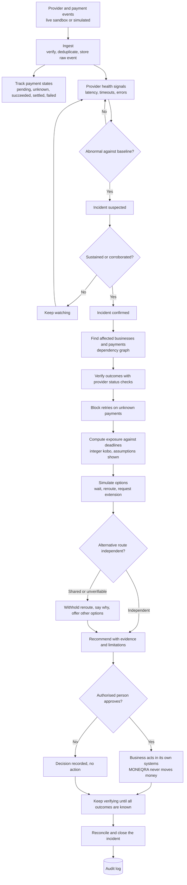

## 5. Worked scenario: Ade Stores

*All figures are illustrative.* Ade Stores is a digital-first retailer that takes online payments through Provider A and Provider B.

**Starting position**

| Item | Amount |
|---|---|
| Available opening funds | ₦150,000 |
| Supplier obligation due at 5pm | ₦1,100,000 |

**14:10 – Provider A starts timing out.** 40 payments worth ₦1,200,000 are affected.

| Payment group | Count | Value | Status |
|---|---|---|---|
| Verified and settled | 28 | ₦840,000 | Counts as available cash |
| Unknown outcome | 12 | ₦360,000 | Never counted as cash; retries blocked |

**Liquidity at 5pm**

Available funds are ₦150,000 + ₦840,000 = **₦990,000** against ₦1,100,000 due.

| Scenario | Unknown payments settled by 5pm | Position at 5pm |
|---|---|---|
| No recovery | ₦0 | **-₦110,000** |
| 60% recovery-and-settlement assumption | ₦216,000 | **+₦106,000** |
| Full recovery | ₦360,000 | **+₦250,000** |

The 60% case is an **assumption**, not a model prediction. A payment eventually succeeding is not the same as the money being available before the supplier deadline.

**What MONEQRA does, step by step**

1. Detects abnormal Provider A behaviour and opens a suspected incident, then confirms it.
2. Walks the dependency graph and finds Ade Stores and its 40 affected payments.
3. Checks each payment with the provider: 28 are verified, 12 remain unknown.
4. Blocks resubmission of the 12 so no customer is charged twice.
5. Calculates the exposure and the three scenarios above.
6. Checks whether Provider B is genuinely independent of the failing route.
7. Simulates the options and recommends one with its evidence and limits.
8. Waits for an authorised person to approve or reject.
9. Keeps verifying until the 12 payments resolve, then reconciles and closes.

**The two demo branches**

| Branch | Provider B relationship to the failure | MONEQRA's recommendation |
|---|---|---|
| Independent | Verified to run on separate infrastructure | Route new checkouts to Provider B, keep verifying the 12 |
| Shared | Runs on the same failing upstream infrastructure | Withhold the switch, explain why, offer an extension request |

## 6. Architecture

MONEQRA is a **modular monolith**: one deployable backend with clearly separated modules, and a web frontend.

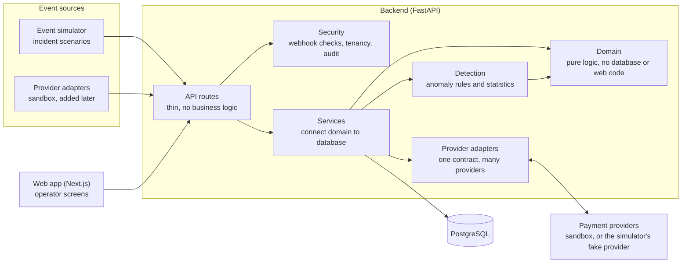

### The five engines

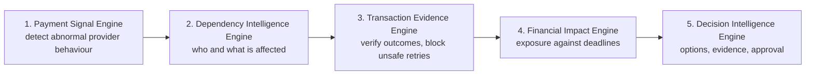

| Engine | Responsibility |
|---|---|
| Payment Signal | Receives events and health signals, detects abnormal behaviour with configurable thresholds, tracks incident timelines, and distinguishes suspected from confirmed. A single timeout does not prove a provider-wide incident. |
| Dependency Intelligence | Models providers, processors, banks, switches and merchants. Finds affected businesses and shared failure domains. Never invents dependencies. |
| Transaction Evidence | Normalises statuses across providers, keeps provider and payment references, verifies outcomes, prevents unsafe retries, and keeps full history. |
| Financial Impact | Calculates confirmed available funds, unresolved inflows, deadline exposure and scenarios, and explains every figure. |
| Decision Intelligence | Compares options, produces recommendations with evidence and uncertainty, routes consequential actions to human approval, and records decisions. |

### Layering rules

1. **`domain` depends on nothing.** No database, web framework, clock or randomness. The current time is passed in.
2. Routes stay thin: check the tenant, call a service, return the result.
3. Dependencies flow one way: routes, then services, then domain and database.
4. Every database query is scoped to an organisation.
5. **Provider adapters** are the only code that knows a provider's URLs, authentication and response formats. They return normalised results; `domain` never sees HTTP. The simulator implements the same adapter contract as a fake provider.

## 7. Domain rules and state machines

### Payment states

| State | Meaning |
|---|---|
| `created` | Exists in MONEQRA, not yet sent to the provider |
| `pending` | Sent to the provider, awaiting an answer |
| `unknown` | No verified outcome. Never counted as cash and never retried |
| `succeeded` | The provider confirmed the payment, but funds may not have reached the business |
| `settled` | Funds have reached the business and are spendable |
| `failed` | Verified failure. Safe to retry |
| `reversed` | A completed payment was undone |

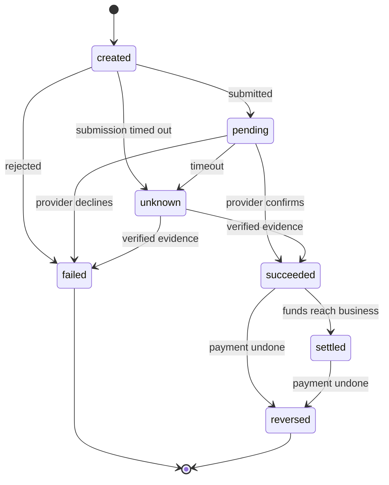

**Rules**

- `unknown` never becomes `failed` automatically. Leaving `unknown` requires evidence from a provider status check, a provider webhook, or manual review. A timeout signal is **not** evidence of an outcome.
- Unknown payments are never resubmitted automatically. Only a verified `failed` payment is retry-eligible.
- A repeated event for the same state is a harmless no-op, because duplicate webhooks are normal.
- Events that cannot be applied (out of order, contradictory, unrecognised) are stored with a reason instead of being dropped.
- The original provider event is always preserved. Payment state is derived from applied events.
- `succeeded` is not spendable cash. Settlement is tracked separately.

### Talking to providers

Adapters implement one contract: ask a provider for a payment's status, ask for settlement status, and (later, with approval) submit an escalation.

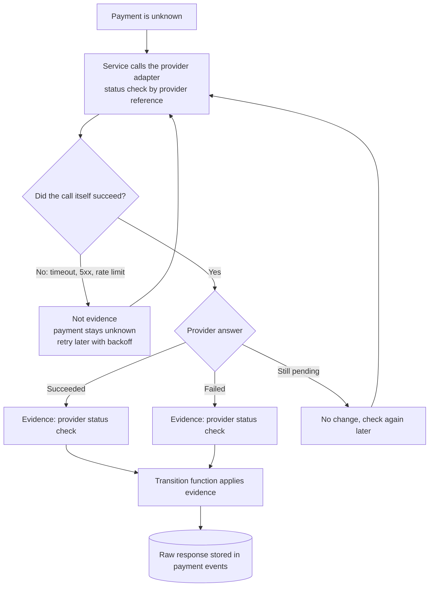

**Rules**

- A failed or timed-out status check is **not** evidence. The payment stays `unknown`.
- Checking a status is safe to repeat. Anything that starts something at a provider must carry an idempotency key.
- Status checks are rate-limited per provider, so MONEQRA does not add load to a struggling provider.
- If a status check and a webhook disagree, both are stored and the latest verified evidence wins by timestamp.
- Provider credentials are stored per organisation, with sandbox and live keys kept separate.

### Incident states

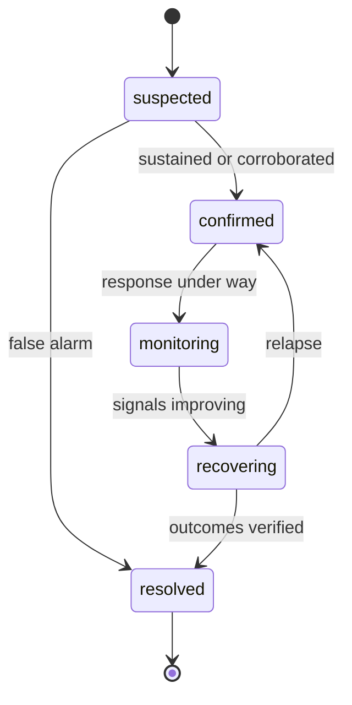

Every transition carries a timestamp and supporting evidence (for example failure rate and latency at that moment).

## 8. Dependency intelligence and route independence

Dependencies are stored as a directed graph. An edge reads "A depends on B" and is marked **known** or **unknown**, with a note saying where it was learned. Dependencies are established from provider documentation, integrations and verified information, never inferred from names.

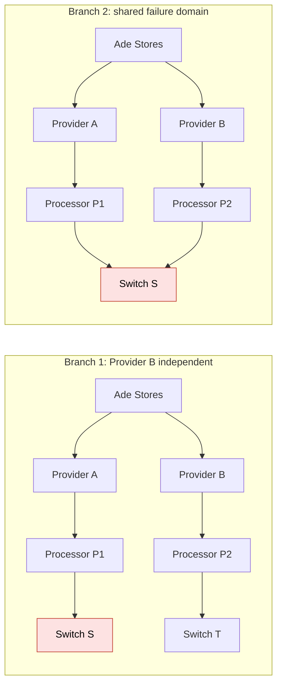

*(Names and topology are illustrative. The failing node is shaded.)*

### Independence verdict

Before recommending a switch to an alternative provider, MONEQRA asks whether the alternative is genuinely independent of the affected route. It has three possible answers, not two.

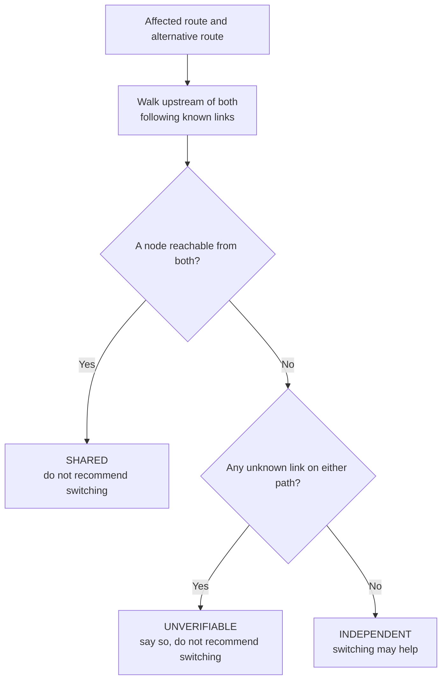

The order matters: a proven overlap is a definite answer even if other links are unknown, so **shared** is checked first. **Independent** is only returned when every link on both paths is known.

## 9. Financial model

All money is **integer kobo** (1 naira = 100 kobo). No floating-point money arithmetic. Probabilities are **integer basis points** (6000 = 60%).

### Payment buckets at a deadline

| Bucket | Counted as cash? |
|---|---|
| Settled on or before the deadline | Yes |
| Settled after the deadline | No (reported) |
| Succeeded, awaiting settlement | No (reported separately) |
| Pending or unknown ("unresolved") | No. Only enters scenarios |
| Created, failed, reversed | Excluded |

### Formulas

```text
available funds        = opening available funds
                         + payments settled by the deadline

obligations due        = sum of obligations due on or before the deadline

worst-case position    = available funds - obligations due

scenario recovery      = unresolved amount x probability
                         (integer basis points, rounded DOWN to whole kobo)

scenario position      = worst-case position + scenario recovery
```

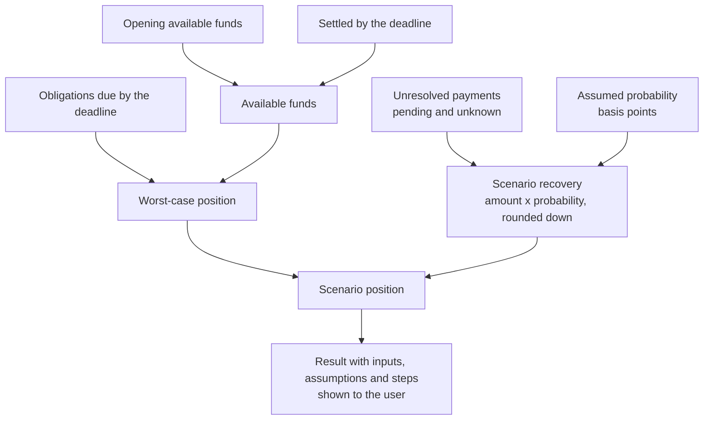

**Rules**

- Unknown payments are never included in confirmed available cash.
- Recovery is rounded **down** so an estimate never creates cash the business does not have.
- Any recovery probability is labelled as an **assumption or model output**, never guaranteed cash.
- Every result lists its inputs, assumptions, time horizon and limitations.
- Settlement timing is an explicit input and visible on screen. "Assumed settled" in the demo data is a stated assumption.
- Mixing currencies is an error.

### Action scenarios

| Action | Affects | Needs an explicit assumption |
|---|---|---|
| Wait and keep verifying | Existing payments | Probability that unresolved payments settle before the deadline |
| Route new payments to another provider | Future payments only | Expected new inflow and its probability |
| Request an extension | The obligation | Probability the counterparty agrees |

Actions that affect existing transactions are kept separate from actions that only affect future ones.

### Cash certainty and coordination

The incident view answers "what is my exposure at one deadline". The bills view extends that to everything that is due.

**Coverage rules** (`backend/app/domain/coverage.py`, pure integer kobo):

1. Confirmed money is the opening balance plus payments already settled. Unresolved payments are never counted as confirmed.
2. Assumed unconfirmed money is `floor(unresolved x recovery_bps / 10000)`. The recovery rate is a stated assumption, never a prediction.
3. Open obligations are walked in due-date order. Ties go to tax, then payroll, loans, rent and utilities, suppliers, other.
4. Each obligation is **covered** (confirmed money pays it), **depends on unconfirmed** (covered only if assumed money arrives) or **at risk** (not covered even then). An at-risk obligation is assumed unpaid, so it uses none of the money and later obligations can still be covered.
5. Totals always add up: covered + depends + at risk = total due.

**Suggested actions** are rule-based: negotiable categories (supplier, rent and utilities, other) get "ask for more time" or "pay in two parts"; tax, payroll and loans get "pay from confirmed money first".

**Coordination workflow:** an operator, approver or admin requests an action; a *different* approver approves or declines it (declining needs a reason); someone carries it out outside MONEQRA and records the outcome. The requester can never approve their own request. Every step is written to the hash-chained audit log. MONEQRA never pays, contacts a supplier or moves money.

## 10. Decision and approval workflow

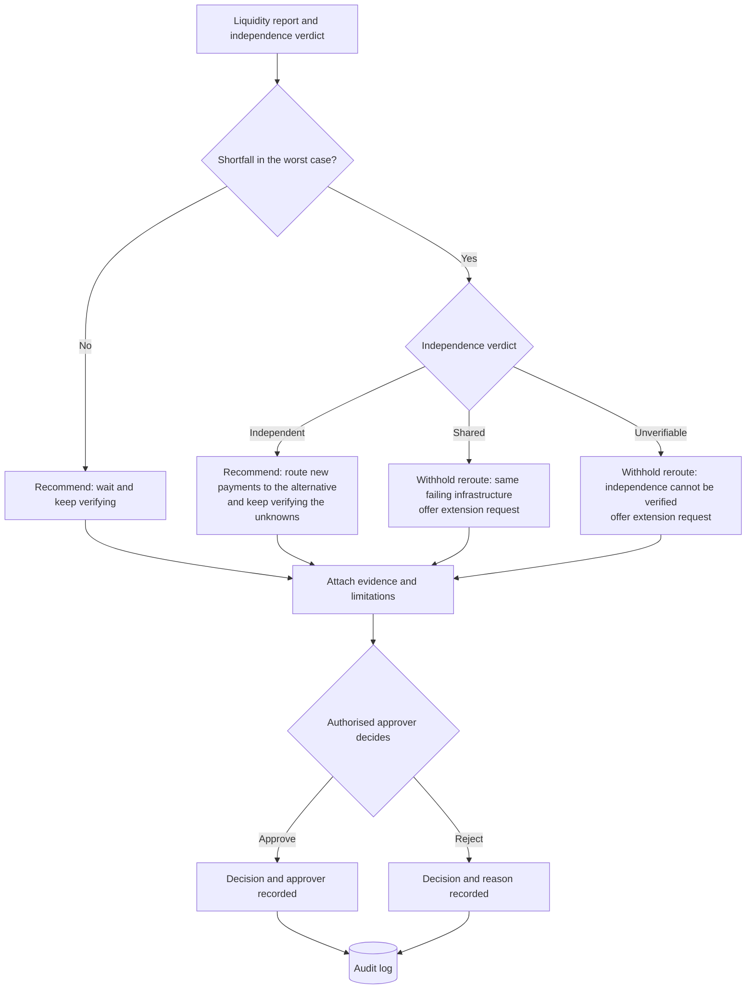

**Action tiers**

| Tier | MONEQRA's behaviour | Examples |
|---|---|---|
| 1. Automatic, read-only | Does it, and logs it | Verify payments with the provider, query settlement status, block resubmission of unknown payments, flag affected businesses |
| 2. Recommend, human approves | Proposes, waits for approval | Reroute new checkouts, request an extension, open a provider escalation or dispute (future: request a reversal, re-initiate a verified-failed payment) |
| 3. Never | Not supported | Moving money autonomously |

Approved actions happen in the business's own systems, or, for provider-side requests, through the adapter after approval. In the MVP, provider communication is read-only status checks plus escalation requests. MONEQRA records every decision and request and continues to verify outcomes.

## 11. Data model

Conventions: every table carries a required `org_id`; primary keys are UUIDs; money is a big integer in kobo plus a currency code; timestamps are timezone-aware UTC; states are stored as text with check constraints; foreign keys restrict deletion; anything simulated carries a `simulated` flag. Append-only tables are never updated or deleted.

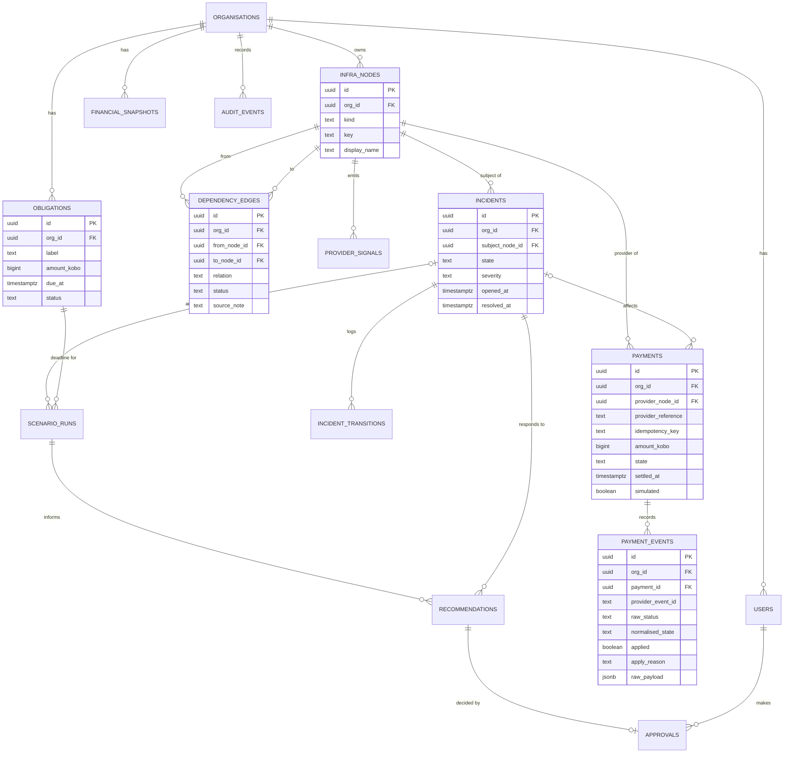

| Table | Purpose | Append-only |
|---|---|---|
| `organisations` | The tenant | |
| `users` | Operators, with roles (viewer, operator, approver, admin) | |
| `infra_nodes` | Merchants, providers, processors, banks, switches, rails | |
| `dependency_edges` | Directed links marked known or unknown, with source notes | |
| `provider_credentials` | Per-organisation provider keys, encrypted, with sandbox and live kept separate | |
| `provider_requests` | Every outbound call to a provider: kind, reference, status, response summary | Yes |
| `payments` | Payments and their current state (a cache of applied events) | |
| `payment_events` | Original provider events, unique per provider event id (duplicate-webhook protection) | Yes |
| `provider_signals` | Latency, timeout and error observations | Yes |
| `incidents` | Incidents and their current state and severity | |
| `incident_transitions` | Timestamped state changes with evidence | Yes |
| `obligations` | Upcoming financial commitments and deadlines | |
| `financial_snapshots` | Available funds at a point in time | Yes |
| `scenario_runs` | Stored inputs and results of each calculation, for reproducibility | |
| `recommendations` | Proposed responses with reasons, evidence and limitations | |
| `approvals` | The decision on a recommendation: who, what, when, why | |
| `audit_events` | Hash-chained record of material actions | Yes |

Key constraints: unique `(org_id, provider_node_id, provider_event_id)` on events; unique `(org_id, idempotency_key)` on payments; amounts must be positive; an edge cannot point at itself; one approval per recommendation.

## 12. API surface (proposed contract)

REST, JSON, versioned under `/v1`. All endpoints are scoped to the caller's organisation. This is the proposed contract the frontend and simulator build against, and it may change until the contract is frozen.

| Method and path | Purpose |
|---|---|
| `GET /health` | Service health |
| `POST /v1/events/payments` | Ingest a payment event (idempotent, safe to repeat) |
| `POST /v1/events/signals` | Ingest a provider health signal |
| `GET /v1/payments` and `GET /v1/payments/{id}` | List payments, and one payment with its event history and retry decision |
| `POST /v1/payments/{id}/verify` | Ask the provider to confirm an unknown payment (read-only, safe to repeat) |
| `GET /v1/incidents` and `GET /v1/incidents/{id}` | Incidents, timeline and evidence |
| `GET /v1/dependency-graph` | Nodes, edges, known and unknown links, affected nodes |
| `GET /v1/obligations` and `POST /v1/obligations` | List obligations, and register one with a category (operator and above) |
| `GET /v1/coverage` | Every open obligation against confirmed money for a stated recovery assumption, with a suggested action |
| `GET /v1/coordination-actions` and `POST /v1/coordination-actions` | List and request coordination actions (ask for more time, split, pay first) |
| `POST /v1/coordination-actions/{id}/decision` | Approve or decline (approver role, never the requester) |
| `POST /v1/coordination-actions/{id}/complete` | Record the outcome of an approved action done outside MONEQRA |
| `GET /v1/financial-impact` | Liquidity report for a deadline |
| `POST /v1/scenarios` | Run a scenario with stated assumptions |
| `GET /v1/recommendations` | Recommendations with evidence and limitations |
| `POST /v1/recommendations/{id}/decision` | Approve or reject (approver role only) |
| `GET /v1/audit` | Audit records |
| `POST /v1/simulator/seed` | Load or reset the simulated scenario (simulation mode only) |

**Event ingestion** returns whether the event was a duplicate and whether it was applied to the payment's state, with the reason when it was not.

## 13. Application screens

Five steps, centred on the incident, the money and the decision. Simulation mode is always visibly marked, and confirmed, pending and estimated values are always visually distinct.

| Screen | Shows |
|---|---|
| **1. Overview and incident** | Infrastructure status, active incidents, timeline, detection evidence, failure and latency changes, severity, unresolved value, available funds, exposure |
| **2. Dependency graph** | Providers, partners, known dependencies, affected nodes, unknown links |
| **3. Evidence and impact** | Transactions with status, verification evidence, settlement status, last provider check and retry eligibility; opening funds, settled inflows, unresolved inflows, obligations, shortfalls |
| **4. Your bills** | Every upcoming bill against confirmed money (covered, only if waiting payments arrive, at risk), a recovery guess selector, suggested actions, and the request, approve and mark-done workflow |
| **5. Scenarios, recommendation and audit** | Option comparison, the recommendation with reasoning, assumptions and limits, approve or reject controls, decision history |

## 14. Security and governance

| Area | Approach |
|---|---|
| Webhook authenticity | Verify provider signatures on the raw body, reject stale or forged events, constant-time comparison |
| Outbound provider calls | Allow-listed provider hosts only, per-provider rate limits, timeouts, credentials never logged, every outbound request recorded |
| Replay and duplicates | Idempotency by provider event id, replay window, no double counting |
| Tenant isolation | `org_id` on every table, every query scoped server-side, cross-tenant tests |
| Secrets | Environment variables or a secrets manager, never in the repository or frontend, separate sandbox and production keys |
| Authentication and roles | Authenticated users with viewer, operator, approver and admin roles. Only approvers can approve |
| Audit | Append-only, hash-chained audit events with actor, action, entity and timestamp |
| LLM boundary | Provider data is untrusted text and is never treated as instructions. The LLM cannot change state, calculate money or approve |
| Control boundary | No autonomous money movement. Consequential actions need human approval |
| Demo safety | No real bank credentials and no real money. Simulated events are labelled |
| Data protection | Synthetic or anonymised data in demos. For real use: consent-based access, data minimisation, retention limits and a privacy impact assessment under Nigeria's data protection law |

## 15. Technology stack

| Layer | Technology |
|---|---|
| Backend | Python, FastAPI, Pydantic, SQLAlchemy |
| Database | PostgreSQL |
| Frontend | Next.js, TypeScript, Tailwind CSS, shadcn/ui, Recharts |
| Testing | pytest, with unit tests on the financial formulas and state machines |
| Explanations | Templates first, with optional LLM polish on structured results only |

## 16. Project structure

```text
moneqra/
├── backend/
│   ├── app/
│   │   ├── main.py            application entry point
│   │   ├── config.py          settings from environment variables
│   │   ├── api/               routes only
│   │   ├── schemas/           request and response contract
│   │   ├── domain/            pure logic
│   │   │   ├── money
│   │   │   ├── errors
│   │   │   ├── payment_states
│   │   │   ├── incident_states
│   │   │   ├── financial_engine
│   │   │   ├── coverage
│   │   │   ├── dependency
│   │   │   └── recommendation
│   │   ├── services/          domain plus database
│   │   ├── prediction/        replaceable interfaces and statistical baselines
│   │   ├── agent/             bounded review tools and approval coordination
│   │   ├── adapters/          provider contract and implementations
│   │   ├── db/                models, session, seed
│   │   ├── security/          webhook verification, tenancy, audit
│   │   └── detection/         anomaly detection
│   └── tests/                 mirrors the app folders
├── simulator/                 event generator, scenarios, fake provider
├── frontend/                  Next.js app
├── contract/                  contract, API spec, seed numbers
└── docs/                      pitch notes, demo script, research
```

## 17. Scope: MVP, simulated, future

| Area | MVP target | Simulated | Future |
|---|---|---|---|
| Incident detection from provider signals | Yes | Signals are simulated | Live provider telemetry |
| Dependency mapping and independence verdict | Yes | Topology is illustrative | Verified real dependency data |
| Transaction verification and retry blocking | Yes | Provider status responses are simulated | Live sandbox adapters |
| Read-only provider checks through adapters | Yes | Fake provider in the simulator | Live provider APIs |
| Provider escalation requests (human approved) | Yes | Simulated | Live provider support channels |
| Approved provider-side reversals or retries | Excluded | | Future, with approval and idempotency |
| Deadline-aware liquidity exposure | Yes | Balances and obligations are seeded | Open Banking and accounting integrations |
| Scenario comparison | Yes | | Calibrated recovery models |
| Bill coverage against confirmed money | Yes | Obligations and balances are seeded | Open Banking and accounting integrations |
| Coordination requests with separate approval | Yes | Simulated | Notifications and supplier-facing messages |
| Agentic financial review | Yes | Deterministic tools and seeded scenarios | Scheduled reviews and replaceable LLM explanations |
| Statistical settlement baseline | Interface only | Baseline unavailable without 20 real settlements | Calibrated and monitored model |
| Deep-learning settlement prediction | Excluded | None; demo data is never used for training | Only after representative real data proves a benefit |
| Executing a payment or contacting a supplier | Excluded | | Excluded |
| Evidence-backed recommendation | Yes | | Learned from real incident history |
| Human approval and audit log | Yes | | Approval workflows and notifications |
| Automated money movement | Excluded | | Excluded |
| Nationwide provider monitoring | | | Future |
| Full accounting or ERP replacement | Excluded | | Excluded |

The CBN Open Banking framework supports customer-permissioned financial data exchange. That does not mean payment-provider incident telemetry is automatically available through it. Each integration still needs its own permissions and provider partnerships.

## 18. Market context and differentiation hypothesis

**Context.** The Central Bank of Nigeria's Payments System Vision 2028 targets include about 99.999% system uptime, roughly a 95% transaction success rate, and full interoperability across licensed payment service providers. Resilience and incident handling are recognised priorities. MONEQRA aims to complement national initiatives, not build another national monitoring centre.

**Differentiation hypothesis (to be validated).**

> What does a payment infrastructure incident do to the financial position of each affected business, and what is the safest decision that business can make right now?

The following capabilities are already competitive territory, so MONEQRA does not rely on any one of them as its edge: multi-provider aggregation, reconciliation, AI-generated transaction insights, and smart routing and failover.

| Category | Examples | Public description | MONEQRA's angle |
|---|---|---|---|
| AI reconciliation and cash visibility | Recital Finance | Connects to thousands of banks, gateways and ERPs for reconciliation, cash visibility and forecasting | Incident-led, deadline-aware decisions during a disruption |
| Provider-native AI | Paystack Command Center | AI questions over a merchant's own Paystack data | Sees one provider only. MONEQRA is cross-provider and obligation-aware |
| Payment orchestration | Payfonte, POPFAB | Routing, failover, analytics and reconciliation | MONEQRA sits above routing and checks whether the alternative is truly independent |
| Multi-provider monitoring and switching | Paye Africa | Unified monitoring and provider switching | Adds financial impact and decision support |
| Institutional reconciliation | Klak, EasyRecon | Reconciliation for banks and fintechs | Merchant-side impact and exposure |
| Fraud detection | Orca Fraud | Real-time cross-rail fraud detection | Different problem: operational exposure, not fraud |
| National infrastructure status | NIBSS status monitoring | Public health view of payment services | A potential data source or partner, not a competitor |

*Based on public descriptions gathered in November 2026 and some team research. Not hands-on tested. Several entries must be verified directly before any claim is made in a pitch. Do not claim exclusivity without testing the closest products.*

## 19. Validation plan and success metrics

**Market validation**

- Interview payment-intensive businesses that use at least two providers.
- Ask about their last significant disruption: how they found unresolved transactions, how they decided the money was really available, and how they chose between retrying, waiting and switching.
- Look for anonymised incident records and for two or three design partners.
- Verify every market statistic against its original source before using it.

**Success metrics**

| Metric | What it proves |
|---|---|
| **Time from incident to quantified business impact** (headline metric) | Core product value |
| Time to detect an incident | Monitoring effectiveness |
| Time to identify affected transactions | Investigation speed |
| Financial projection error | Mathematical reliability |
| Unsafe retries prevented | Transaction safety |
| Independent fallback routes correctly identified | Operational resilience |
| Time to reconcile the incident | Recovery effectiveness |

## 20. Build plan and ownership

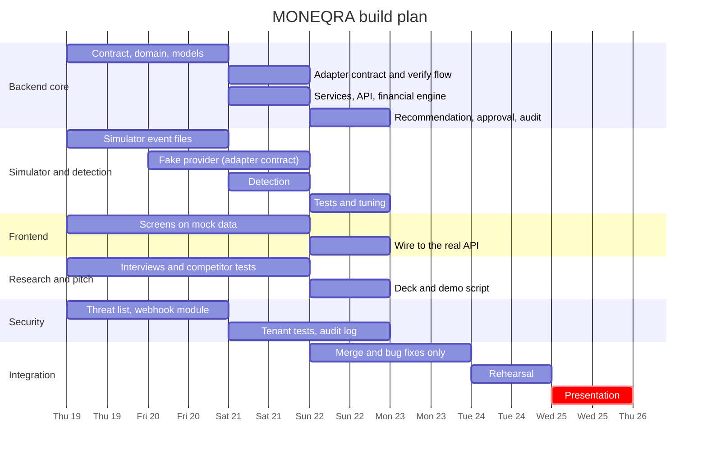

| Person | Area | Folders |
|---|---|---|
| Tiolu (team lead) | Backend core: API, schemas, domain, services, database, adapter contract | `api`, `schemas`, `domain`, `services`, `db`, `adapters` |
| Olaniyi Olanike | Simulator, fake provider (implements the adapter contract) and anomaly detection | `simulator`, `detection` |
| Delight | Frontend and product design, including verification status and escalation approval | `frontend` |
| Jumoke Akande | Research (real provider status and verify endpoints, rate limits, escalation processes), competitor testing, pitch | `docs` |
| Security owner (to be confirmed) | Webhook verification, tenancy tests, audit log, credential storage and outbound call controls | `security` |

**Merge checkpoints:** Friday night, a contract-drift check. Saturday night, the simulator, detection and backend run together. Sunday night, the frontend is wired to the real API and one full demo run works. Monday, bug fixes only, then freeze.

## 21. Risks and limitations

| Risk | Mitigation |
|---|---|
| Too much scope for five build days | Four screens, one organisation seeded, one scenario with two branches. Optional work must be switchable off |
| Demo data mistaken for real | Simulation mode is always visible, and `simulated` is stored on records |
| "Assumed settled" funds may not be spendable at the deadline | Settlement is an explicit, visible input and is reported separately from success |
| Recovery probabilities are assumptions | Labelled as assumptions, never counted as cash, rounded down |
| Detection from one merchant's own traffic may not tell a provider-wide incident from a local problem | Suspected versus confirmed states, corroboration rules, and wording that never claims certainty |
| Unknown infrastructure dependencies | Unknown links are shown as unknown, and the independence verdict can answer "unverifiable" |
| Closest competitors may already cover parts of this | Test them directly and keep claims to what has been verified |
| Status checks overload a struggling provider | Per-provider rate limits, backoff, capped concurrency |
| Duplicate and out-of-order webhooks | Idempotency keys, stored-but-not-applied events, replay-safe design |

**Limitations.** MONEQRA is a prototype. It has not been validated with real merchants or real incident data. Its dependency graph is illustrative. It does not integrate with production payment systems.

## 22. Glossary

| Term | Meaning |
|---|---|
| Kobo | One hundredth of a naira. All money is stored as integer kobo |
| Basis points | Integer probability units: 10,000 = 100%, 6,000 = 60% |
| Unknown payment | A payment whose outcome is not verified. Never counted as cash and never retried |
| Succeeded vs settled | Succeeded means the provider confirmed it. Settled means the money reached the business |
| Evidence | A provider status check, a provider webhook or a manual review. A timeout is not evidence of an outcome |
| Failure domain | Shared infrastructure whose failure can affect several providers or routes at once |
| Route independence | Whether an alternative payment route is verifiably free of the failing infrastructure |
| Exposure | The potential shortfall against obligations due by a deadline |
| Idempotency | Processing the same event more than once has the same effect as once |
| Provider adapter | The only code that talks to a payment provider. Translates provider responses into MONEQRA's normalised states |
| Financial twin | The business's modelled financial position: funds, pending items, expected receipts and obligations |

---

*Team SYNFORGE. MONEQRA is an early-stage prototype. Figures and events are illustrative.*